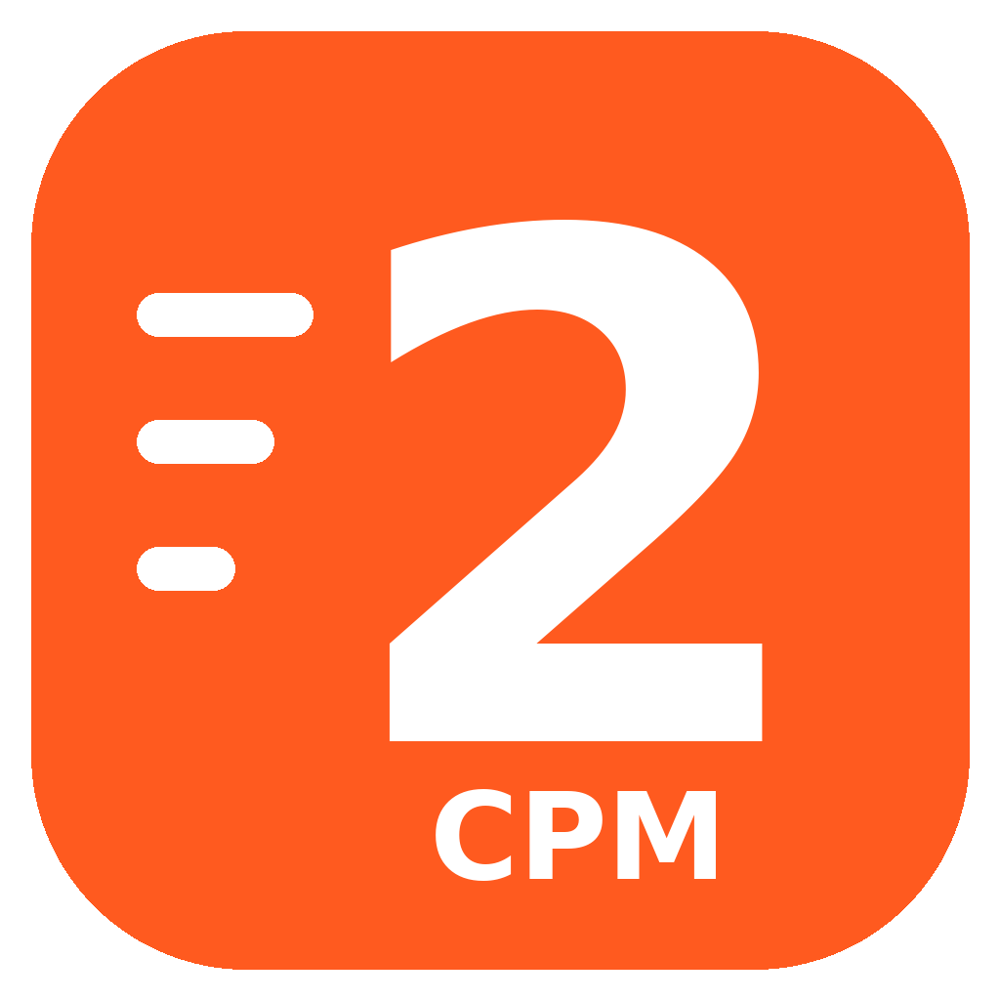

# CPM 2 Tuner

Graphics and performance tuner for **Car Parking Multiplayer 2** (Steam).

**Download:** [CPM2 Tuner.exe](https://github.com/zptf/cpm2-tuner/raw/main/CPM2%20Tuner.exe), then run it. Nothing to install. The tuner updates itself from this repo.

## Features
- Graphics presets (Ultra+, Balanced Beauty, Max FPS...) plus your own, with import/export
- Settings beyond the in-game sliders, with FPS cost for each one
- Hidden settings tester
- FPS monitor with in-game overlay and session reports (Intel PresentMon, MIT license)
- Screenshot before/after comparison
- Preset by time of day
- Steam launch options, GPU preference, CPU priority, cleanup
- ReShade on/off and lean preset
- Discord status, tray mode, PT / EN

## Safe by design
Edits only the game's settings file, Steam launch options and a Windows GPU preference.
Never touches game files, memory or save data.

---
App built by: zptf
